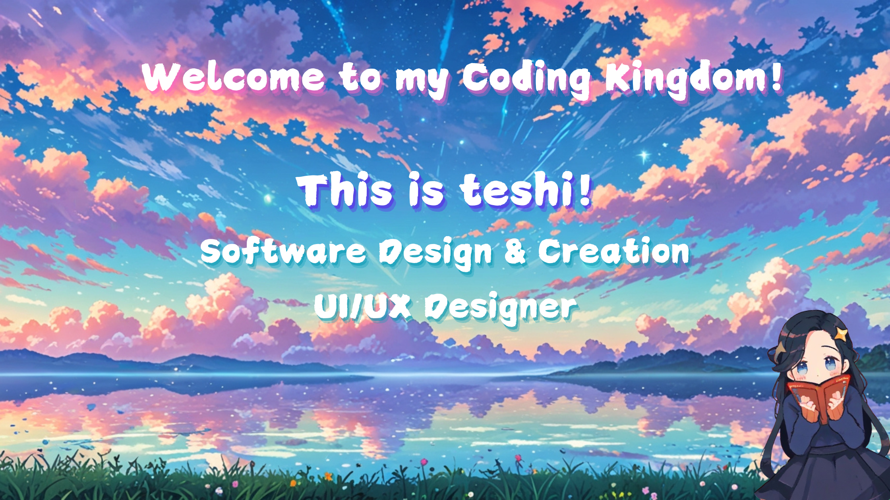

[](https://hits.sh/github.com/Teshidesu/) 

<p align="center">
   
</p>

</div>

## 📘 My Current Studies  
I am currently in my `second year` pursuing a technical degree in `Software Design and Creation` at the **National Institute of Professional Technical Training**. Throughout my studies, I have been developing strong skills in software development, problem-solving, and system design. Excited to apply my knowledge in real-world projects and make an impact in the `tech industry!` 🚀  

## 💫 About Me 
🚀 `Lead Developer` in a dynamic software project, 
guiding the team towards innovation and efficiency. 💻✨  
🔭I am working on creating a `Mini Website project`<br>🧸I'm currently learning `How to create an API` <br>💬Ask me about....Cozy games + Nintendo 🎮 <br>🥁`Software Developer` | `Future designer!`<br>🧙‍♂️PixelMage...creating magical potion to brew op some TypeScript☕️🧙‍♂️ <br>🎫I enjoy `Swimming` as a hobby<br>🏆𝘐 𝘥𝘰𝘯'𝘵 𝘧𝘶𝘭𝘧𝘪𝘭𝘭 𝘨𝘰𝘢𝘭𝘴, 𝘐 𝘶𝘯𝘭𝘰𝘤𝘬 𝘢𝘤𝘩𝘪𝘦𝘷𝘦𝘮𝘦𝘯𝘵𝘴! <br> <br>`phrase of the day`"My wand is the keyboard, and my spell is the code"🎇<br>  
  
</div>


# 🛠 Tech Stack & Tools  
<p align="center">
  <a href="https://skillicons.dev">
    
  </a>
</p>

## ✍️ Random Dev Quote 
<div align="center" width="50">
 
 

 
</div>

## 📜 Here is a Magical Manifesto 
**I promise to face every challenge in the world with courage and persistence, knowing that every difficulty is an opportunity to learn and grow....**

 

```python
def conjure_code():
     while Learner:
         Practice()
         To experience()
         Create()
```
##
**Every mistake is a step towards success, every obstacle a test of my determination. Despite momentary defeats, I bravely persist, knowing that each line of code written brings me closer to my goals...**
<p align="center">
  <a>
     
  </a>
</p>

## 
*Thank you for visiting my profile! I hope you find what you're looking for and enjoy exploring. If you need help or have any questions, don't hesitate to contact me. Welcome and thank you for being here!* 💚 <div align="center">

